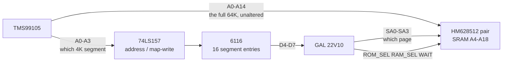
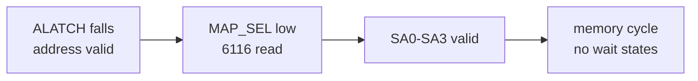

# The TMS99105 SBC memory mapper

The CPU can address 64K. The board has 1MB. Rather than intercept the address
bus, this design leaves it completely alone and has a GAL contribute four
*extra* address lines alongside it — so a program uses far more memory than it
can address, at no cost in cycles and without knowing anything about it.

This page describes the hardware. How programs use it is described under
[Using the mapper](#using-the-mapper) at the end.

---

## The hardware: the address bus is never touched



The CPU's `A0-A14` go straight to the SRAMs and address the whole 64K exactly
as they would with no mapper present. Nothing is intercepted, substituted or
delayed.

In parallel, the top four address bits index a 6116 holding one entry per 4K
segment. Its upper nibble reaches the GAL, which emits **SA0-SA3** — four
*additional* address lines. The SRAM address is therefore 19 bits wide where
the CPU only drove 15: the address space is **extended**, not rewritten.

| SRAM pins | Driven by |
| --- | --- |
| `A0-A3` | `SA0-SA3` from the GAL — the page |
| `A4-A18` | `A0-A14` from the CPU — the 64K address |

A GAL term decides which segments are mapped at all:

```
IS_PAGED = (A0 & !A1) # (A1 & !A2) # (A2 & !A0) # (A3 & !A0)
```

| Segments | Behaviour |
| --- | --- |
| 0 (`>0000-0FFF`) | **Common** — always page 0 |
| 1-D (`>1000-DFFF`) | **Paged** — whatever the 6116 says |
| E, F (`>E000-FFFF`) | **Common** — BDOS and ROM, always present |

Common segments matter more than they look. Code that changes the map cannot
live in a segment it is changing, so the gates that switch pages sit in segment
0, and the BDOS stays reachable whatever the mapper is doing.

### Free of charge, in the shadow of the address latch



The lookup overlaps the address-latch phase of the same cycle. `MAP_SEL` goes
low at mid-ALATCH and stays low 218.75 ns — 3.5 T at 16 MHz — which is settled
well before the data is needed. The mapper costs no CPU time at all.

### One 6116, two jobs

The same 6116 has to be written by the CPU when the map changes, and read by
the hardware on every cycle. A 74LS157 switches its address inputs: `A0-A3`
during normal operation, `A11-A14` when `MAP_REG` selects the map for writing.
Only the upper nibble of each entry is used, so sixteen bytes describe the
entire address space.

---

## Using the mapper

- **Why it pays:**
  - **Swapping is a CRU write.** No copying, no disk access: every page is
    loaded once when the program starts, then mapped in and out.
  - **The address is stable.** The CPU's address passes through untouched, so
    an address inside a page means the same offset whichever page is mapped.
    Code compiled to run at `>8000` runs from any page mapped there.
  - **The compiler never knows.** Overlays are ordinary C compiled to run at
    their window address: no far pointers, no banking annotations.
- **OVL99** is the overlay system the SBC's programs use. The linker
  (`link99 -Y`) reads one overlay map and builds the overlay table and a small
  resident thunk per published function, so a call into an overlay is an
  ordinary C call.
- **Start here:** [`ovl99_demo`](../ovl99_demo/) — OVLDEMO, the smallest
  complete OVL99 program, with a one-step Windows build.
- **Full implementations**, in the
  [TMS99105-Native-Toolchain](https://github.com/AlexanderAdelAU/TMS99105-Native-Toolchain):
  - FileEdit — the screen editor
  - LINK99 — the native linker, itself an OVL99 program
  - [SMALLC99](https://github.com/AlexanderAdelAU/SmallC99-TMS99105-Native-C-Compiler) —
    the native C compiler, eight overlays in a 16K window
- **Reference:**
  - [OVL99.md](https://github.com/AlexanderAdelAU/TMS99105-Native-Toolchain/blob/main/OVL99.md) —
    the runtime, the table, the map format and the rules
  - [TMS99105-SBC-V4-Paged-Memory-System](https://github.com/AlexanderAdelAU/TMS99105-SBC-V4-Paged-Memory-System) —
    programming the map registers and PSEL, the EXE chain format, the loader,
    and the SMALLC99 walk-through
