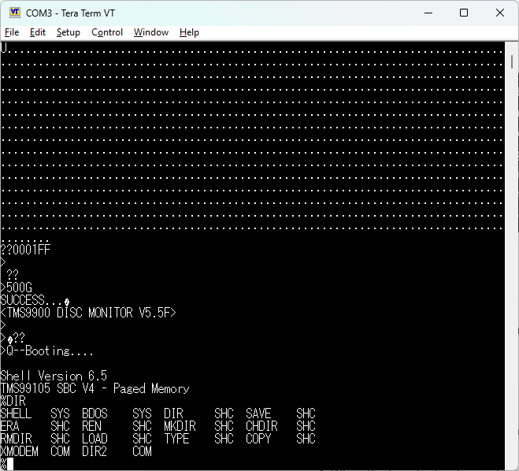

# TMS99105 SBC — System Build

This repository contains the current source build for the TMS99105 SBC
operating-system volume: DSKINIT62, BDOS61, XMODEM59, standalone DIR2,
Shell 6.5 and its ten command pages.

**One command builds the complete operating-system volume:**

```bat
MAKE_SYSTEM.bat
```

The script stages every component in `Build`, assembles all modules,
generates the Shell address include, runs SYSGEN and copies the resulting
`PAYLOAD65.HEX` to the sibling `../MONITOR` upload-staging directory. It also
builds the standalone utilities in `SRC/Utilities` and copies their `.H99`
files to the same directory; these are not included in the SYSGEN volume.

## Upload and boot the SBC

After `MAKE_SYSTEM.bat` reports `BUILD OK`, the payload is ready to transfer:

1. Open **Tera Term 5** and connect to the SBC's Disc Monitor over the
   serial connection.
2. At the Disc Monitor prompt, enter **`U`** to start an Intel HEX upload.
3. From Tera Term, send **`PAYLOAD65.HEX`** from the sibling `../MONITOR`
   staging directory. Wait until the complete file has transferred.
4. At the monitor prompt, enter **`500G`** to execute the system generator
   loaded at address **`>0500`** (`0x0500`).
5. Confirm that the generator displays **`SUCCESS`**. Then enter **`Q`**
   at the Disc Monitor prompt to boot the **Shell and BDOS**.

Do not execute `500G` until the transfer has finished. If `SUCCESS` does
not appear, investigate the upload or system-generation error before
attempting to boot.



*Example Tera Term session: upload progress dots, `500G` producing `SUCCESS`,
then `Q` booting Shell 6.5 and `DIR` listing the installed system files.*

## Repository layout

| Folder | Purpose |
| --- | --- |
| [`SRC/BDOS`](SRC/BDOS/README.md) | BDOS 6.1 and its regression-test source |
| [`SRC/DISC_MONITOR`](SRC/DISC_MONITOR/README.md) | Independent Disc Monitor ROM source; not part of SYSGEN |
| [`SRC/DSKINIT`](SRC/DSKINIT/README.md) | Disk initialiser 6.2 |
| [`SRC/Utilities`](SRC/Utilities/README.md) | Standalone uploadable test and debug programs; excluded from SYSGEN |
| [`SRC/XMODEM`](SRC/XMODEM/README.md) | XMODEM 5.9 |
| [`SRC/SHELL`](SRC/SHELL/README.md) | Shell 6.5 core, ten command pages, and standalone DIR2 |
| [`SRC/SYSGEN`](SRC/SYSGEN/README.md) | Host-side system volume packer (`sysgen.c`) |
| `Includes` | Maintained assembler include files |
| `Toolchain` | Windows A99 assembler and MKCINC utility; R99, LINK99, Small-C and PACK99 for the OVL99 demos |
| `Build` | Generated working files; created automatically |
| `../MONITOR` | Sibling staging directory for `PAYLOAD65.HEX`, utility `.H99` files and the Disc Monitor ROM `.H99`; created automatically |

`SRC/DISC_MONITOR` contains the Disc Monitor source. `MAKE_SYSTEM.bat`
assembles it on every build and stages its `.H99` for the ROM programmer,
but it is **not** included by SYSGEN.

Each source component has its own README beside its source files.
See [BUILDING.md](BUILDING.md) for the complete build instructions.

## Hardware drawings and project references

The original hardware and reference material has been restored alongside
this build, with its original directory names:

- [`Documents`](Documents/) — processor manuals and reference documents.
- [`Schematics`](Schematics/) — SBC schematic PDFs, including versions 2–5.
- [`Memory Structure`](Memory%20Structure/) — architecture and memory-map drawings.
- [`Memory Mapper`](Memory%20Mapper/) — how the memory mapper hardware works, with links to the overlay system that uses it.
- [`ovl99_c_demo`](ovl99_c_demo/) — OVLDEMO, a minimal OVL99 overlay application in C, with a one-step Windows build.
- [`ovl99_asm_demo`](ovl99_asm_demo/) — OVLTEST, the same overlay mechanism with every module written in assembler.
- [`ovl99_runtime`](ovl99_runtime/) — the OVL99 runtime (`OVLMGR.A99`, `OVCALL.A99`) that both demos link unchanged.
- [`images`](images/) — hardware photographs and illustrations.

The original root-level schematic drawings are now together under
[`Schematics`](Schematics/Readme.md), including the
[`SBC schematic (PDF)`](Schematics/SBC_Schematic.pdf),
[`SBC schematic (PNG)`](Schematics/SBC_Schematic.png),
[`Memory Mapping Schematic`](Schematics/Memory%20Mapping%20Schematic.png), and
[`Memory Mapped Architecture Schematic`](Schematics/Memory%20Mapped%20Architecture%20Schematic.png).

These reference materials are not inputs to `MAKE_SYSTEM.bat`. The old
`Disc_Monitor` source folder remains consolidated under `SRC/DISC_MONITOR`,
and the previously separated SmallC99 project is not duplicated here.
